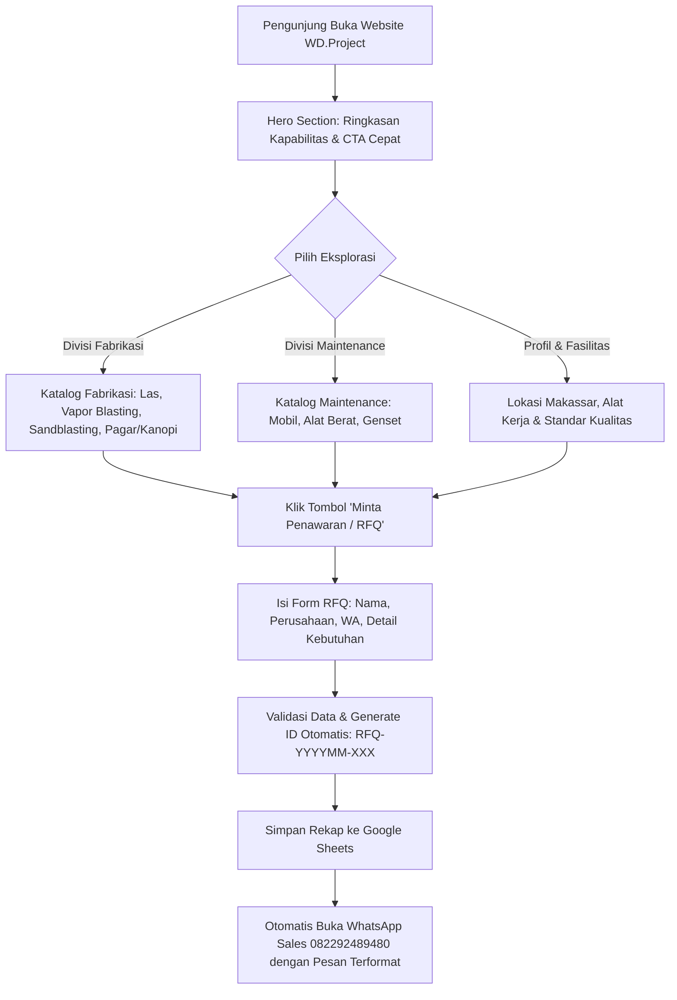

# DOKUMEN SPESIFIKASI KEBUTUHAN PRODUK (PRD)
# SISTEM WEBSITE & FORM PENAWARAN (RFQ): WD.PROJECT

================================================================================
ZONA ATAS: SPESIFIKASI KEBUTUHAN PRODUK (BLUEPRINT AWAL)
================================================================================

## 1. NAMA PROJEK & PROBLEM STATEMENT
- **Nama Projek:** Website Company Profile & Portal Penawaran B2B WD.Project (Fabrication & Maintenance).
- **Brand / Merek:** WD.Project.
- **Slogan / Tagline:** "Precision Fabrication & Heavy Equipment Maintenance Specialist".
- **Kontak Resmi:** WhatsApp: +62 822-9248-9480.
- **Lokasi Workshop:** Jl. Balang Turungan, Paccerakkang, Kec. Biringkanaya, Kota Makassar, Sulawesi Selatan, 90241.
- **Problem Statement:**
  Bisnis workshop fabrikasi dan maintenance seringkali terkendala oleh citra konvensional (bengkel pinggir jalan) sehingga sulit memenangkan tender atau pesanan bernilai tinggi dari klien perusahaan, kontraktor, dan instansi industri. WD.Project membutuhkan kehadiran digital (website) berstandar industri manufaktur global (seperti referensi American Eagle Manufacturing) yang:
  1. Menampilkan kredibilitas visual tingkat tinggi dengan logo resmi oranye-hitam WD.Project.
  2. Memisahkan secara tegas dan rapi antara 2 pilar bisnis utama: **Divisi Fabrikasi** (Pengelasan, Vapor Blasting, Sandblasting, Pagar, Kanopi, Tralis Jendela, dsb) dan **Divisi Maintenance** (Perbaikan Mobil, Alat Berat, Genset Industri, dsb).
  3. Mempermudah calon klien mengajukan permohonan estimasi harga melalui Formulir Permintaan Penawaran (Request for Quotation / RFQ) yang otomatis tersimpan ke Google Sheets dan terhubung langsung ke WhatsApp tim estimator.

---

## 2. PERAN PENGGUNA (USER ROLES)
1. **Calon Klien / Pengunjung Publik:**
   - Mempelajari kapabilitas workshop, fasilitas permesinan, dan standar pengerjaan.
   - Menjelajahi katalog layanan Divisi Fabrikasi & Divisi Maintenance.
   - Melihat portofolio foto pengerjaan proyek riil.
   - Mengisi formulir RFQ (Permintaan Penawaran Harga) atau berkonsultasi langsung via WhatsApp.
2. **Tim Sales & Estimator WD.Project:**
   - Menerima pesan masuk penawaran terformat otomatis di WhatsApp (+62 822-9248-9480).
   - Memantau rekap histori leads / calon klien yang masuk di lembar kerja Google Sheets.
3. **Administrator Workshop:**
   - Mengelola pembaruan kontak, daftar layanan, dan informasi pengerjaan proyek.

---

## 3. ARSITEKTUR & LINGKUNGAN KERJA
- **Pendekatan Desain:** *Anti-AI Human-Crafted Aesthetic* (Estetika B2B Manufaktur Modern).
  - Palet Warna Utama:
    * *Industrial Slate Dark:* `#0F172A` & `#1E293B` (Karakter kokoh, baja, engineering).
    * *Safety Amber / Construction Orange:* `#F97316` & `#EA580C` (Mengacu pada warna oranye pada logo resmi WD.Project).
    * *Clean Steel Gray / White:* `#F8FAFC` & `#FFFFFF` (Keterbacaan teks maksimal, bersih, formal).
  - Tipografi & Ikonografi: Font sans-serif berbobot tegas (Inter / Plus Jakarta Sans) dipadukan dengan ikon vektor SVG tajam dan minimalis (tanpa emoji norak).
  - Navigasi: Navbar fixed dengan sticky backdrop blur, navigasi responsif dengan tombol darurat WhatsApp di header.
- **Lingkungan Teknologi:**
  - **Frontend:** Single-Page Application (SPA) responsif (HTML5, Tailwind CSS via CDN, Vanilla JavaScript modular).
  - **Backend Controller:** Google Apps Script (`code.gs`) yang mengontrol fungsi API penerimaan data penawaran.
  - **Database:** Google Sheets (tab `PermintaanPenawaran` & `KatalogLayanan`) dengan Safe Migration (`setup.gs`).
  - **Integrasi Eksternal:** WhatsApp Click-to-Chat API dengan format template pesan otomatis.

---

## 4. ALUR KERJA APLIKASI (USER FLOW)

---

## 5. DESAIN BASIS DATA (GOOGLE SHEETS)
Sesuai aturan baku, penamaan tab sheet **TIDAK MENGGUNAKAN UNDERSCORE (_)** dan pembacaan backend berbasis indeks array (0-based).

### Tabel 1: `PermintaanPenawaran`
Menyimpan seluruh data leads dan permohonan harga yang dikirim pengunjung website.
- Kolom A (Indeks 0): `IDPenawaran` (Contoh: `RFQ-202611-001`)
- Kolom B (Indeks 1): `TanggalWaktu` (Format: `YYYY-MM-DD HH:mm:ss`)
- Kolom C (Indeks 2): `NamaKlien` (Contoh: `Bapak Ridwan`)
- Kolom D (Indeks 3): `NamaPerusahaan` (Contoh: `PT Makassar Baja Mandiri` atau `-`)
- Kolom E (Indeks 4): `NoWhatsApp` (Contoh: `08123456789`)
- Kolom F (Indeks 5): `DivisiLayanan` (Nilai: `Fabrikasi` / `Maintenance` / `Konsultasi Khusus`)
- Kolom G (Indeks 6): `SpesifikasiKebutuhan` (Contoh: `Sandblasting tangki 5000L & pengerjaan pagar kanopi workshop`)
- Kolom H (Indeks 7): `Status` (Default: `Baru`, opsi: `Diproses`, `Selesai`, `Dibatalkan`)
- Kolom I (Indeks 8): `CatatanInternal` (Contoh: `Sudah dikirim penawaran PDF via WA`)

### Tabel 2: `KatalogLayanan`
Menyimpan master data layanan yang tampil di website.
- Kolom A (Indeks 0): `IDLayanan` (Contoh: `SRV-001`)
- Kolom B (Indeks 1): `Divisi` (Nilai: `Fabrikasi` / `Maintenance`)
- Kolom C (Indeks 2): `NamaLayanan` (Contoh: `Vapor Blasting & Sandblasting`)
- Kolom D (Indeks 3): `DeskripsiSingkat` (Deskripsi teknis proses dan hasil permukaan logam)
- Kolom E (Indeks 4): `StatusAktif` (Nilai: `Aktif` / `Nonaktif`)

---

## 6. ATURAN VALIDASI & LOGIKA KHUSUS
1. **Penomoran Kode Unik Otomatis (Sequential ID Generator):**
   - Format: `RFQ-YYYYMM-XXX` (Contoh: `RFQ-202611-001`).
   - Logika Backend: Memindai urutan tertinggi pada bulan berjalan di Google Sheets menggunakan `LockService.getScriptLock()` untuk mencegah duplikasi data jika diakses multi-user.
2. **Validasi Formulir:**
   - Wajib diawali `event.preventDefault();` pada submit handler.
   - Nama Pengirim: Minimal 3 karakter.
   - Nomor WhatsApp: Validasi numerik minimal 10 digit, otomatis konversi awalan `08` menjadi format internasional `628`.
   - Divisi & Kebutuhan Proyek: Wajib dipilih/diisi.
3. **Bebas Distorsi Waktu & Sinkronisasi Instan:**
   - Pencatatan tanggal backend wajib menggunakan `Utilities.formatDate(new Date(), 'Asia/Jakarta', 'yyyy-MM-dd HH:mm:ss')`.
   - Operasi penulisan spreadsheet diakhiri pemanggilan `SpreadsheetApp.flush()`.
4. **Anti-Deadlock Button:**
   - Tombol submit menampilkan loading spinner dan status `disabled = true`.
   - Wajib dilengkapi `.withFailureHandler()` untuk mengembalikan tombol ke keadaan aktif bila jaringan terputus.

---

## 7. RENCANA ANTARMUKA PENGGUNA (UI SPECIFICATION)
Website dirancang dengan 8 seksi utama berstandar website manufaktur B2B:

1. **Top Bar & Navigation Bar:**
   - Logo resmi WD.Project (Oranye & Hitam).
   - Tautan menu: Beranda, Divisi Fabrikasi, Divisi Maintenance, Tentang & Fasilitas, Portofolio, Kontak.
   - Tombol Aksi Kanan: "Konsultasi WhatsApp" (tombol berwarna oranye beraksen tajam).
2. **Hero Section (B2B Industrial Showcase):**
   - Headline: "Solusi Terpadu Fabrikasi Presisi & Maintenance Alat Berat di Makassar".
   - Sub-headline: "Didukung peralatan modern pengelasan, teknologi vapor blasting & sandblasting, serta teknisi berpengalaman untuk kebutuhan industri, komersial, maupun residensial."
   - Lencana Kredibilitas: "Workshop Resmi - Biringkanaya, Makassar" & "Respon Cepat 24/7".
   - Tombol CTA: "Ajukan Penawaran Harga (RFQ)" & "Hubungi Teknisi".
3. **Seksi Pilar Bisnis Utama (Tab Interaktif):**
   - **Tab A - Divisi Fabrikasi:**
     * Pengelasan Presisi (Welding MMA/TIG/MIG).
     * Vapor Blasting & Sandblasting (Pembersihan karat, restorasi mesin, finishing permukaan logam tanpa merusak dimensi).
     * Fabrikasi Pagar & Pintu Industri.
     * Kanopi Minimalis & Heavy Duty.
     * Tralis Jendela & Pengaman Besi.
     * Fabrikasi Khusus / Custom Steel Works.
   - **Tab B - Divisi Maintenance:**
     * Perawatan & Perbaikan Mobil (Fleet kendaraan operasional & pribadi).
     * Maintenance & Overhaul Alat Berat (Excavator, Loader, Forklift, dsb).
     * Servis & Perawatan Berkala Genset Industri (Preventive maintenance, re-wiring, tuning).
     * Servis Panggilan Lapangan (On-Site Emergency Repair).
4. **Seksi Keunggulan Workshop (Why WD.Project):**
   - 4 Kartu Metrik/Nilai: Presisi Pengerjaan Tinggi, Alat Blasting Ramah Lingkungan & Bersih, Teknisi Bersertifikat, Jaminan Garansi Mutu.
5. **Seksi Portofolio & Galeri Pengerjaan:**
   - Galeri foto dinamis dengan filter kategori (Semua, Fabrikasi, Blasting, Maintenance).
6. **Seksi Alur Kerja Sama (How We Work):**
   - 4 Langkah Mudah: Konsultasi/RFQ -> Survei & Estimasi Biaya -> Pengerjaan Workshop -> Uji Kelayakan & Serah Terima.
7. **Seksi Formulir RFQ (Request for Quotation):**
   - Formulir terstruktur dengan field: Nama Lengkap, Perusahaan/Instansi, WhatsApp, Pilihan Divisi, Rincian Proyek/Kebutuhan.
   - Tombol submit dengan notifikasi status instan.
8. **Footer & Lokasi Peta:**
   - Alamat lengkap: Jl. Balang Turungan, Paccerakkang, Kec. Biringkanaya, Makassar.
   - Jam operasional workshop, kontak darurat, dan hak cipta resmi WD.Project.

---

## 8. KRITERIA PENGUJIAN (TESTING CRITERIA)
- [ ] Tampilan website responsif sempurna di layar HP (360px - 414px) maupun desktop (1080p+).
- [ ] Logo resmi WD.Project tampil tajam dan proporsional di header dan footer.
- [ ] Tombol navigasi menu scrolling dengan mulus (*smooth scrolling*) ke bagian yang dituju.
- [ ] Tab peralihan Divisi Fabrikasi dan Divisi Maintenance bekerja instan tanpa reload halaman.
- [ ] Formulir RFQ memvalidasi nomor telepon dan input wajib sebelum dikirim.
- [ ] Data formulir tersimpan rapi ke baris baru Google Sheets tab `PermintaanPenawaran`.
- [ ] Calon klien otomatis diarahkan ke chat WhatsApp resmi `082292489480` dengan draf teks penawaran yang sudah terformat rapi.
- [ ] Tombol submit tidak macet (*anti-deadlock*) ketika terjadi gangguan koneksi.

================================================================================
ZONA BAWAH: MASTER CONTEXT & LOGIKA SISTEM TERKINI (LIVING CONTEXT)
================================================================================
- **Status Arsitektur Aktif:** Next.js 14 App Router + Tailwind CSS (Vercel Native Deployment, SSR/SSG, Global Edge CDN, SSL Otomatis).
- **Tema Visual Aktif:** Modern B2B Light / White Theme (Background `#FFFFFF` & `#F8FAFC`, tipografi tajam Slate `#0F172A`, aksen Safety Orange `#F97316`).
- **Konfigurasi Framework:** `next.config.js`, `tailwind.config.js`, `postcss.config.js`, `package.json`.
- **Identitas Brand Aktif:** WD.Project (Fabrication & Maintenance).
- **Nomor Layanan Resmi:** +62 822-9248-9480.
- **Lokasi Fisik:** Jl. Balang Turungan, Paccerakkang, Kec. Biringkanaya, Kota Makassar, Sulawesi Selatan, 90241.
- **Aset Visual:** Logo resmi transparan tanpa latar kotak tersimpan di `public/assets/logo.png`.
- **Logika Alur RFQ Terkini:**
  * Penomoran tiket otomatis `RFQ-YYYYMM-XXX` dihitung sekuensial secara client-side via LocalStorage.
  * Penyimpanan histori prospek lokal browser (`wd_rfq_history`).
  * Direct Click-to-Chat WhatsApp API ke nomor admin resmi dengan format pesan proposal siap kirim.
  * 0ms cold-start, kebal terhadap downtime pihak ketiga.
- **Riwayat Log Pembaruan:**
  * *v1.3 (2026-11-19):* Penerapan tema latar putih (Light Theme) secara menyeluruh pada semua komponen antarmuka, penghapusan latar kotak putih pada logo sehingga menjadi transparan murni, dan penjaminan nol perubahan script fungsional.
  * *v1.2 (2026-11-19):* Migrasi penuh ke arsitektur Next.js 14 App Router, pemecahan 9 komponen modular UI, pembersihan berkas lama (index.html statis, Google Apps Script setup.gs/code.gs), serta pembaruan panduan deploy.
  * *v1.1 (2026-11-19):* Migrasi arsitektur dari Google Apps Script ke Vercel Jamstack Platform sesuai instruksi pengguna.
  * *v1.0 (2026-11-18):* Inisiasi rancangan spesifikasi sistem PRD untuk website WD.Project mengacu pada referensi manufaktur American Eagle B2B dan logo resmi.

